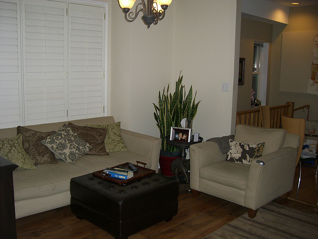
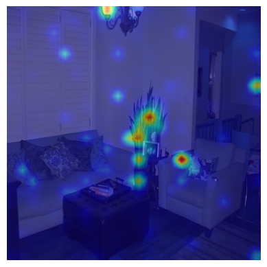
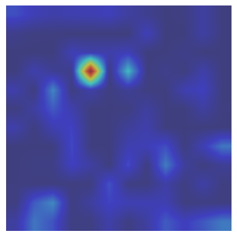
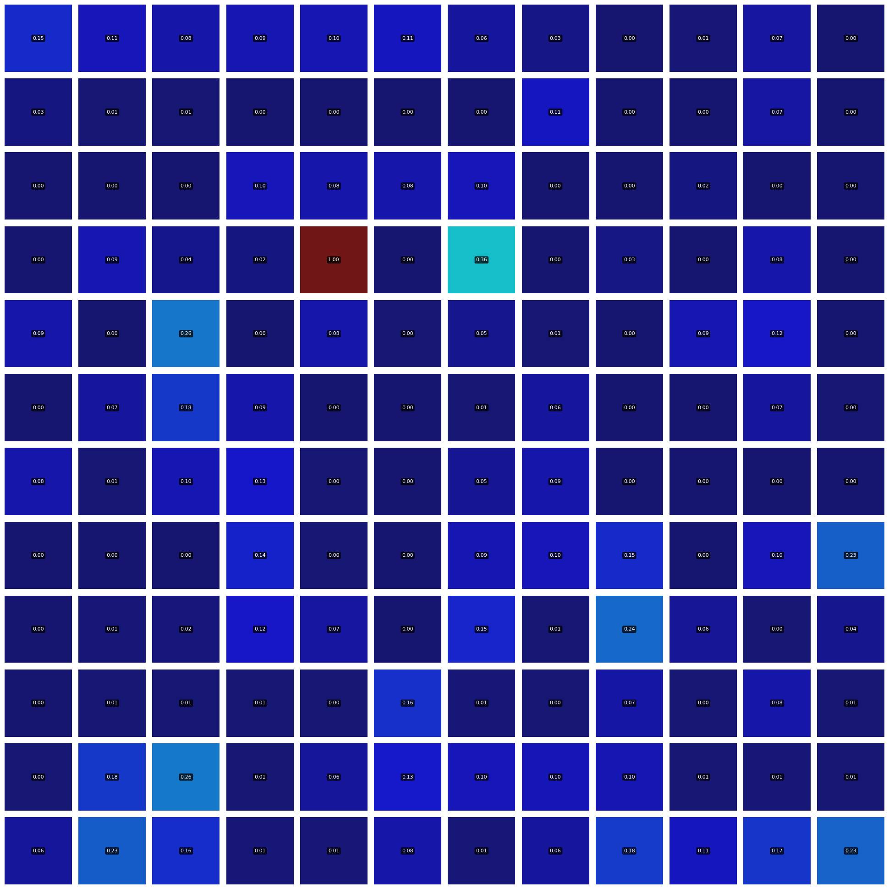
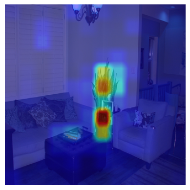
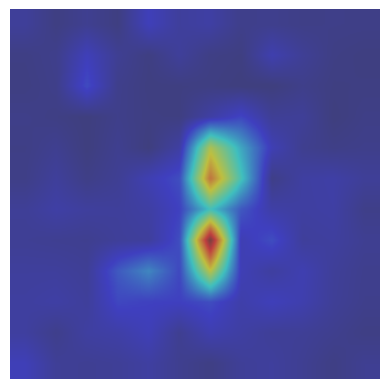
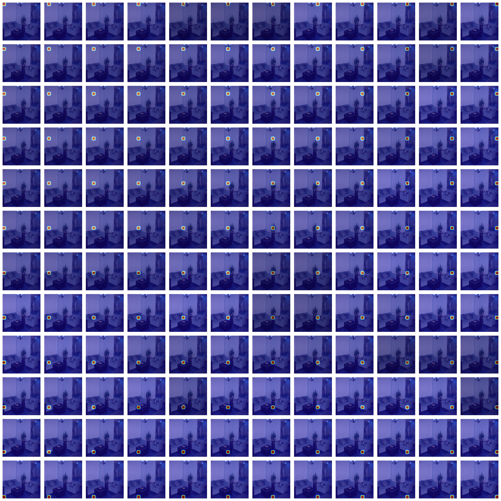
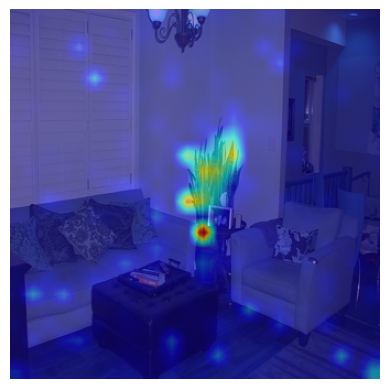
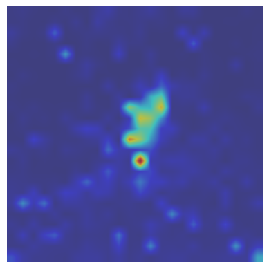
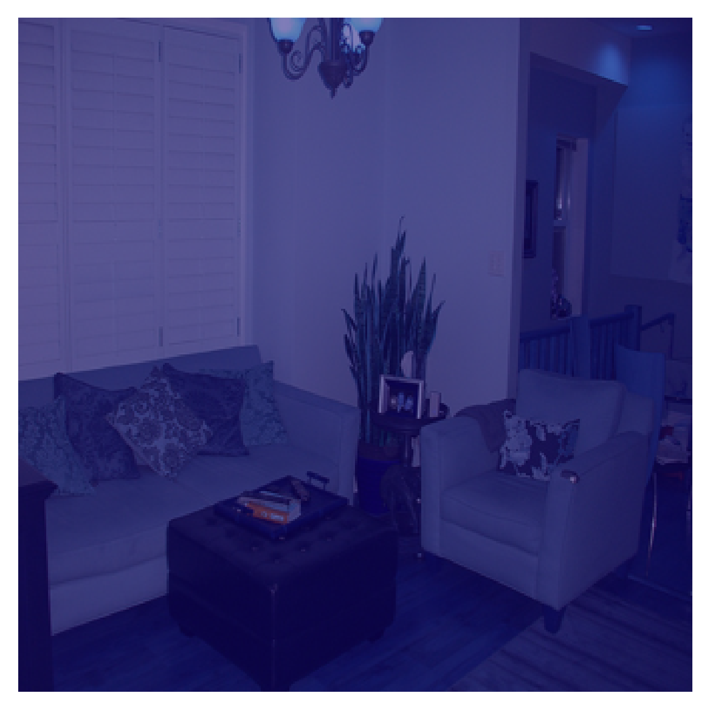

# [DeCo: Decoupling token compression from semantic abstraction in multimodal large language models](https://arxiv.org/abs/2405.20985)

#### 📰 News

We have released the **R-GAE** explainability tool to visualize vision-language semantic flows in MLLMs.

---

This study examines the projector module by interpreting the vision-language semantic flow within MLLMs. Our findings reveal that compressive projectors (e.g., QFormer), abstract visual patches into a limited set of semantic concepts, such as objects or attributes, resulting in a '*double abstraction*' phenomenon. The double abstraction is inefficient in training and will result in cumulative vision semantics deficiency. To mitigate this issue, we propose the key insight of **Decouple Compression from Abstraction (DeCo)**, *that is compressing the visual token number at the patch level by projectors and allowing the LLM to handle visual semantic abstraction entirely*. Consequently, we adopt a simple compressor, i.e., **2D Adaptive Pooling**, to downsample visual patches in a parameter-free manner. Empirical evaluation demonstrates that DeCo surpasses traditional compressive projectors regarding both performance and efficiency. It achieves performance gains of 0.9%, 7.1%, and 2.9% across the MLLM Benchmarks, Visual Localization, and Open-ended VQA tasks with fewer trainable parameters and faster convergence speed.


We visualize the vision-language relevance maps across the same MLLM architecture except for projector modules in the following figure. The linear projector is non-compressive while the Q-Former and Adaptive Average Pooling (ours) compress the original 576 vision tokens to 64 tokens. Text-to-Patch relevance reveals the effective vision semantics aligned with the LLM during image-to-text generation. For Q-Former in the second row, its Query-to-Patch map discards the fine-grained visual semantics about “purple and red”. This semantic deficiency is transmitted to the final Text-to-Patch map and leads to a misalignment of vision patches and textual words.


# 2D Adaptive Pooling

Under the DeCo architecture, we employ the 2D Adaptive Average Pooling as a natural downsampler of the visual tokens at the patch level. Given N patch tokens from the ViT, the adaptive pooling can reduce the token number N to a lesser square number M.  These tokens are finally projected by the linear layer to match the textual embedding dimension, serving as visual inputs to the LLM.

The core code using 2D Adaptive Pooling as the projector is:

```python
class AvgPoolProjector(nn.Module):
    def __init__(
        self,
        layer_num: int = 2,
        query_num: int = 144,
        mm_hidden_size: int = 1024,
        llm_hidden_size: int = 4096,
    ):
        super().__init__()
        self.layer_num = layer_num
        self.query_num = query_num
        self.mm_hidden_size = mm_hidden_size
        self.llm_hidden_size = llm_hidden_size
        self.build_net()
        
    def build_net(self):
        hw = int(self.query_num ** 0.5)
        sampler = nn.AdaptiveAvgPool2d((hw, hw))
        self.sampler = sampler
        modules = [nn.Linear(self.mm_hidden_size, self.llm_hidden_size)]
        for _ in range(1, self.layer_num):
            modules.append(nn.GELU())
            modules.append(nn.Linear(self.llm_hidden_size, self.llm_hidden_size))
        self.mlp_projector = nn.Sequential(*modules)
        
    def forward(self, visual_feat: torch.Tensor) -> torch.Tensor:
        batch_size, seq_len, h_dim = visual_feat.shape  # 576
        hw = int(seq_len ** 0.5)  # 24
        shaped_visual_feat = rearrange(visual_feat, "b (h w) d -> b d h w", h=hw, w=hw)  # torch.Size([B, 1024, 24, 24])
        pooled_visual_feat = self.sampler(shaped_visual_feat)  # torch.Size([B, 1024, 12, 12])
        reshaped_visual_feat = rearrange(pooled_visual_feat, "b d h w -> b (h w) d")  # [B, 144, 1024]
        output_feat = self.mlp_projector(reshaped_visual_feat)  # [B, 144, 4096])
        return output_feat
```

# 🔍 R-GAE Explainability Tool

### Install Environment
```bash
conda create -n deco-explain python=3.10 -y
conda activate deco-explain
pip install --upgrade pip  # enable PEP 660 support
pip install -e .
pip install webdataset "numpy<2"
pip install opencv-python captum scikit-image pycocotools
```
### (Optional) For users in China

```bash
export HF_ENDPOINT=https://hf-mirror.com
```

### Input Format

- **Image resolution**: 336x336 (ViT patch size 14 → 576 tokens)
- **Text prompt**: e.g., `"A pot of green plants"`
- **An input image**: e.g., `"./examples/COCO_train2014_000000334463.jpg"`

---

### 🧠 Projectors

We compare three types of vision-language projectors:

| Type            | Compression | Description                              |
|-----------------|-------------|------------------------------------------|
| `linear`        | ✖ No        | Projects features without compression     |
| `qformer`       | ✅ 576→144   | Query-based semantic abstraction         |
| `avgpool (DeCo)`| ✅ 576→144   | Patch-level compression only (ours)      |

---

### 📦 Pretrained Models

You can download all checkpoints from the [Hugging Face organization](https://huggingface.co/yaolily).
```bash
llava_model_paths=(
    'liuhaotian/llava-v1.5-7b'
    'yaolily/llava-v1.5-7b-qformer2_144-lora'
    'yaolily/llava-v1.5-7b-avgpool2_144-lora'
)

mm_projector_types=(
    'mlp2x_gelu'
    'qformer2_144' # 2 layers and output 144 query tokens 
    'avgpool2_144'
)
```

### Example Inference Script

```bash
gpu_id=0
img="./examples/COCO_train2014_000000334463.jpg"
txt="A pot of green plants"
vis_save_path="./visualize_output/"
baseline="rgae" # you can also set other baselines like 'rawattn' and 'gradcam'

length=${#llava_model_paths[@]}
for ((i=0; i<${length}; i++)); do
    llava_model_path=${llava_model_paths[$i]}
    mm_projector_type=${mm_projector_types[$i]}
    echo "Running model: $llava_model_path with projector: $mm_projector_type"

    CUDA_VISIBLE_DEVICES=$gpu_id python ./llava/explainability/get_R-GAE_example.py \
        --llava_model_path $llava_model_path \
        --mm_projector_type $mm_projector_type \
        --visualize \
        --vis_save_path $vis_save_path \
        --image_path $img \
        --target_text $txt \
        --set_baseline $baseline
done
```


## 📊 Sample Visualization
Input Image and Text Prompt:
### "A pot of green plants"



### Q-Former (576->144 visual tokens)

Here is an example visualization for the `qformer2_144` projector, which uses 12x12 query tokens. The visualization, prompted by "A pot of green plants", decouples the final `Text-to-Image` relevance map.

The visualization below decouples the final `Text-to-Image` relevance (`R_t2i`) into two stages, following the formula **`R_t2i` = `R_t2q` x `R_q2i`**:

with heatmap `R_t2q`: `R_t_q-rgae-A-pot-of-green-plants-qformer2_144-.png`
| `R_t2i` (Text-to-Image) | `R_t2q` (Text-to-Query) | `R_q2i` (Query-to-Image) |
| :---: | :---: | :---: |
|  |  |  |

or with grid map `R_t2q`: `R_t_q-rgae-A-pot-of-green-plants-qformer2_144-_grid.png`

| `R_t2i` (Text-to-Image) | `R_t2q` (Text-to-Query) | `R_q2i` (Query-to-Image) |
| :---: | :---: | :---: |
|  |  |  |


- **`R_t2i` (left)**: The final aggregated relevance map that highlights the image regions most relevant to the generated text, resulting from the combination of the next two maps.
- **`R_t2q` (middle)**: This grid shows the importance of each of the 144 query tokens for generating the text. The color intensity of each cell indicates the token's relevance to the text prompt.
- **`R_q2i` (right)**: This grid visualizes the spatial focus of each query token on the image. Each cell is a heatmap showing where that specific token is "looking".

### Average Pooling (576->144 visual tokens)

| `R_t2i` (Text-to-Image) | `R_t2q` (Text-to-Query) | `R_q2i` (Query-to-Image) |
| :---: | :---: | :---: |
|  |  |  |


### MLP layers (576 visual tokens)

| `R_t2i` (Text-to-Image) | `R_t2q` (Text-to-Query) | `R_q2i` (Query-to-Image) |
| :---: | :---: | :---: |
|  |  |  |